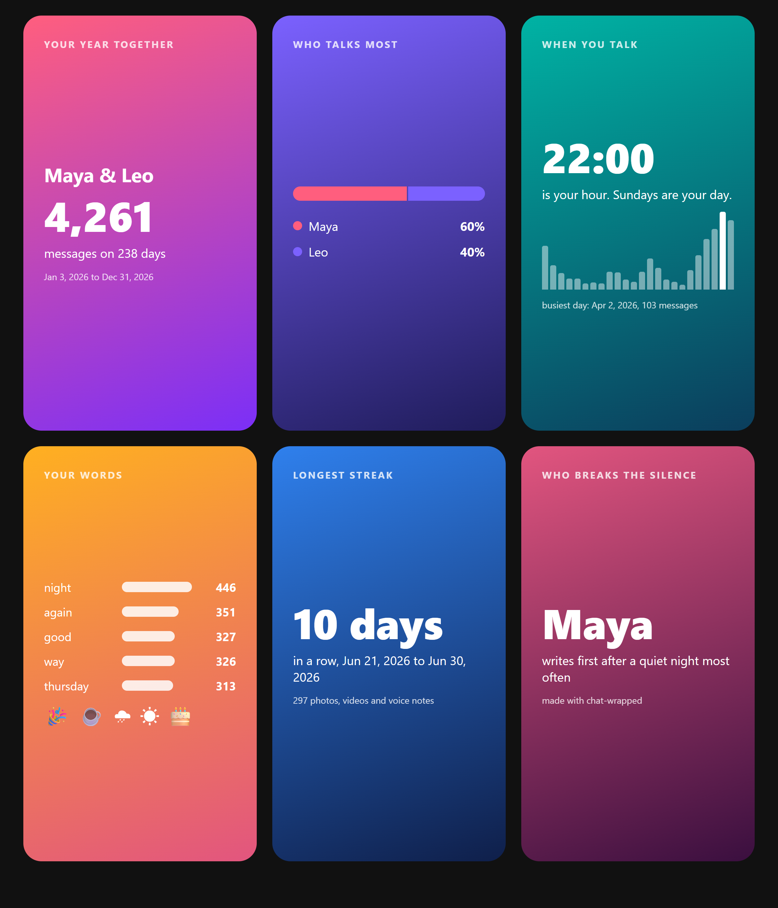
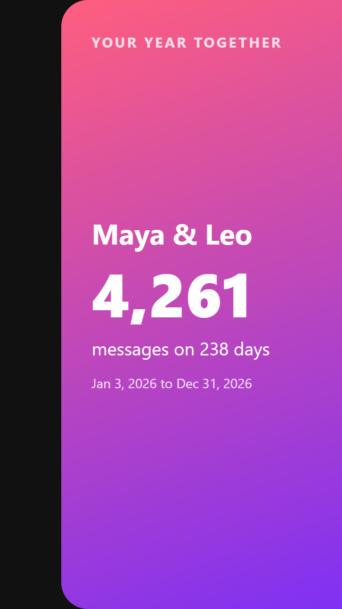
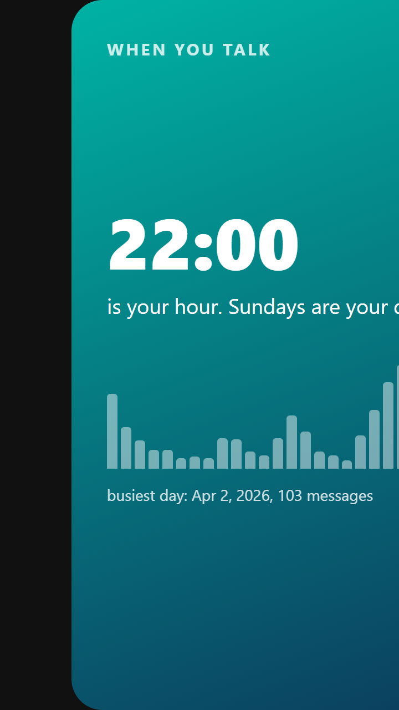
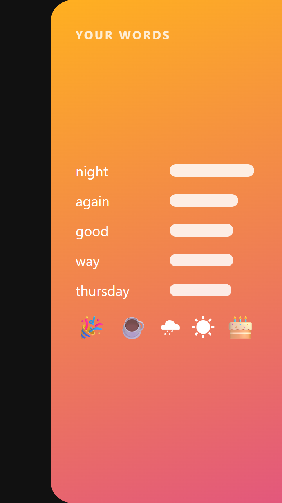
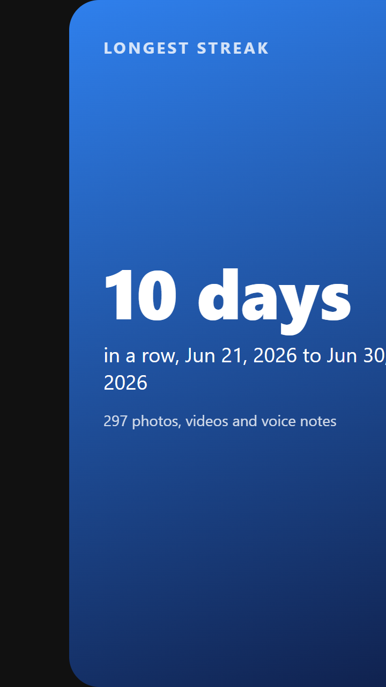
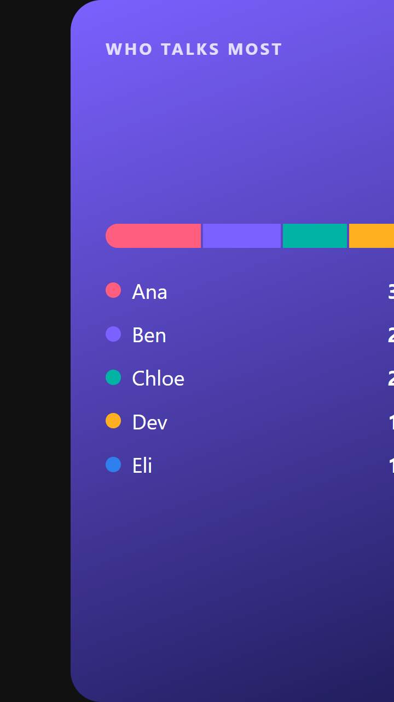
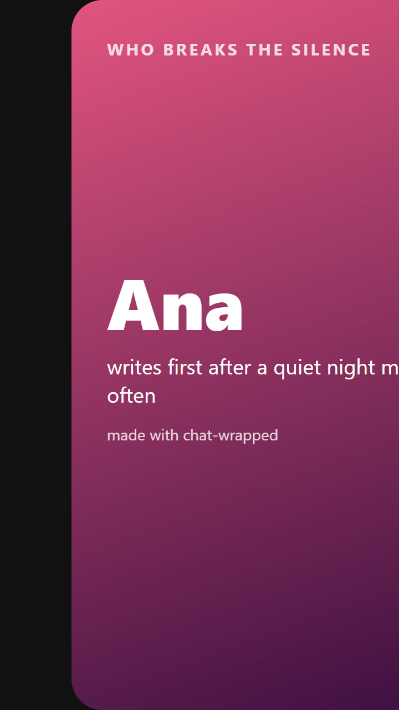

<div align="center">

# chat-wrapped

**Turn any WhatsApp chat into a year-in-review story you can share, and search it like an agent would.**

Spotify Wrapped for your group chat: who talks most, your hour, your words, your longest streak. It is made from the chat you export from WhatsApp, on your own computer, with the search rules of whatsapp-mcp and the decode-in effect of ascii-reveal.

 

Works with **Claude Code** and **Codex**.



</div>

The picture above is the real output of `python chat_wrapped.py --demo --png`. The demo chat is made up ([examples/make_chat.py](examples/make_chat.py)). In the browser, every number and word on a card decodes into place.

## Quick start
In WhatsApp, open a chat, tap the name, then **Export chat > Without media**, and save the `.txt`. Then:
```bash
git clone https://github.com/Dodai0419/chat-wrapped && cd chat-wrapped
python chat_wrapped.py "WhatsApp Chat with Maya.txt" -o out --png
```
```text
chat-wrapped: 4,261 messages on 238 days (Maya 2545, Leo 1716); longest streak 10 days -> out/wrapped.html
chat-wrapped: card-1..6.png and wrapped.png in out
```
Open `out/wrapped.html`, or post `out/card-1.png` ... `card-6.png` (720 x 1280, the 9:16 story shape). One Python file, Python 3.8+ standard library only; `--png` needs Chrome or Edge.

## Gallery
Every image is a real run on the made-up chats in [examples/](examples/).

| Input | Cards |
|---|---|
| Two friends, iPhone export: `python chat_wrapped.py --demo -o docs --png` |   |
| The same chat, more cards |   |
| A five-person group, Android export (month/day, 12-hour clock): `python chat_wrapped.py examples/hiking-club.txt --title "Hiking club" -o docs/hiking --png` |   |

All six group cards: [docs/hiking/wrapped.png](docs/hiking/wrapped.png).

## Search it
```bash
python chat_wrapped.py chat.txt --search "flight*" '"booked for thursday"' CAFE --since 2026-03-01
```
```text
## flight* (2 matches)
[2026-12-21 22:44] Maya: the flights are booked for thursday ✈️
...
## CAFE (2 matches)
[2026-12-29 18:33] Maya: found a café that does oat flat whites
```
| You type | It finds |
|---|---|
| `lease` | "lease" as a whole word, never "release" |
| `CAFE` | café, Café, CAFÉ: case and accents are ignored |
| `thursday flight` | messages with both words |
| `"booked for thursday"` | those words together, in that order |
| `flight*` | flight, flights, flighty |

Add `--sender NAME`, `--since` / `--until YYYY-MM-DD`, `--limit N`, or `--json` for one JSON object per hit. Several queries run in one pass over the chat.

## The problem
- WhatsApp has no year in review, and the stats sites want you to upload your private chat to them.
- WhatsApp's own search matches inside words and has no phrases, so "lease" also finds "release".
- A table of numbers is not something anyone shares; a story card is.

## The solution
| Idea | Fixes |
|------|-------|
| **Reads the export file on your machine** | Nothing is uploaded; the HTML is one file with no network requests |
| **whatsapp-mcp's search rules** (whole words, accents folded, phrases, prefixes, newest first) | Search that finds what you meant, from the terminal or from your coding agent |
| **Six story cards** sized for Instagram and WhatsApp Status | Something people actually post |
| **ascii-reveal's decode** (a wave from the centre, a density ramp, then scrambled glyphs) with the real text always in the page | Cards that look alive, while screen readers read the real text and reduced-motion users get a short fade |

## Use with Claude Code
```bash
/plugin marketplace add Dodai0419/chat-wrapped
/plugin install chat-wrapped@chat-wrapped
```
Then ask: "Make a wrapped story of my chat export ~/Downloads/WhatsApp Chat with Maya.txt", or "When did Leo say the flights were booked?".

## Use with Codex (ChatGPT)
```bash
git clone https://github.com/Dodai0419/chat-wrapped && cp -r chat-wrapped/skills/* ~/.codex/skills/
```
Or copy [AGENTS.md](AGENTS.md) into your project root.

## Options
| Flag | What it does |
|---|---|
| `CHAT.txt` | the exported chat (iPhone or Android format, any date order) |
| `-o DIR` | output folder (default `out`) |
| `--title NAME` | name on the first card (default: the file name) |
| `--year 2026` | only that calendar year |
| `--dates dmy\|mdy` | date order, when the guess is wrong (it is guessed from days above 12) |
| `--png` | also `card-1.png` ... `card-6.png` and `wrapped.png` |
| `--search Q ...` | search instead of making cards |
| `--demo` | use the bundled made-up chat |

## Benchmarks
Windows 11, Python 3.11.1, `python bench/bench.py` (median of 5 runs per row; the script run 4 times on 2026-10-28, range shown, typical value in brackets) on the demo chat (4,261 messages). The numbers swing up to 2x with background load, so treat them as rough:

| | upstream | chat-wrapped |
|---|---|---|
| search 4 queries in one pass | whatsapp-mcp: not run here (a Cloudflare Worker linked to your WhatsApp account; its docs say each search decrypts the history and "takes a few seconds") | 84-213 ms (~120) with `--limit 30`, 256-459 ms (~330) with no limit |
| same answers | reference | the search checks in whatsapp-mcp's `test/store.test.mts` pass on the same messages (tests/test_chat_wrapped.py) |
| parse the export | not part of whatsapp-mcp (it reads WhatsApp's live sync) | 34-103 ms (~45) |
| stats + six cards | | 151-220 ms (~200) |
| decode effect code | ascii-reveal `src/core/engine.ts`: 1,366 non-blank lines, React 17+ | 45 lines of plain JavaScript inside the page, for text only |
| code for the search | whatsapp-mcp `src/store.ts`: 569 non-blank lines (store, encryption, search) and 5 dependencies | part of `chat_wrapped.py` (288 non-blank lines in all), no dependencies |

What it does not do: whatsapp-mcp reads every chat live and keeps it encrypted; chat-wrapped reads one exported file. ascii-reveal also decodes images and skeleton loaders; chat-wrapped decodes text only.

## FAQ
**Is my chat uploaded?** No. The script reads the file and writes HTML and PNGs to the folder you choose. The page loads nothing from the internet.

**Group chats?** Yes, up to six people get their own colour; everyone is counted.

**Another language?** Search works in any script (the tests include Hebrew). The "top words" list skips common English filler words only.

## Inspired by
- [finereli/whatsapp-mcp](https://github.com/finereli/whatsapp-mcp): the query language and matching (fold, whole words, phrases, prefixes, newest first, batches that stop early) and its test cases.
- [quanhoangindex/ascii-reveal](https://github.com/quanhoangindex/ascii-reveal): the `decode` preset (ramp, scramble glyphs, 60 ms tick), the `fast` timing (wave at 3.2 px/ms, 220 ms cap, 90-200 ms per character), ~30 fps repaint, real text kept in the DOM, reduced-motion fade.

## Roadmap
- [ ] Telegram and Signal exports
- [ ] A "you two vs the group" card for group chats
- [ ] An animated video export of the cards

## License
MIT. See [LICENSE](LICENSE) and [NOTICE](NOTICE).
